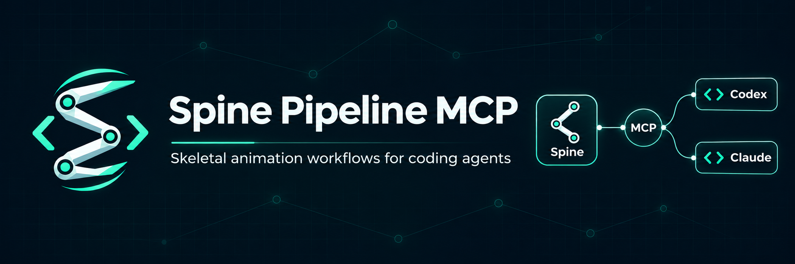
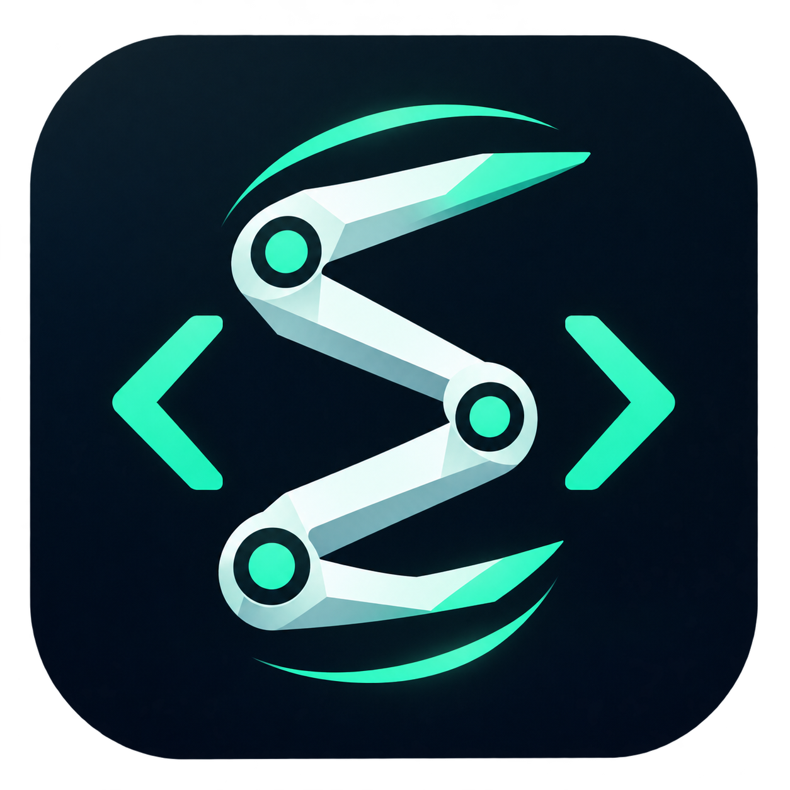

# Spine2d-mcp



[](LICENSE)

**A local, staging-first MCP foundation for Spine asset pipelines.**

The repository/display name is **Spine2d-mcp**; the Python package and executable remain `spine-pipeline-mcp` for existing client compatibility. The project icon is unchanged. The banner uses the official, unmodified Spine mark only to identify compatibility; Codex and Claude Code are plain-text labels, not official logos or endorsements. See [third-party notices](THIRD_PARTY_NOTICES.md).

[中文说明](docs/README.zh-CN.md) · [Install / marketplaces](docs/distribution.md) · [Connect Codex / Claude](docs/clients.md) · [Authoring skills](docs/skills.md) · [Architecture](docs/architecture.md) · [Security](SECURITY.md) · [Contributing](CONTRIBUTING.md)

> **Early prototype, project version 0.2.0.** This repository uses the official Python MCP SDK **2.3.0**. That SDK version is not a claim of “MCP protocol 2.0”, FastMCP 2.x, or project version 2.0. The fifteen tools below are implemented. Output remains staging-only; there is no publication tool.

## Install MCP + Skills

The **MCP executes tools**; the **Skills guide the agent's workflow**. Use both for asset preparation → Spine rigging/animation → runtime integration. All paths and game-specific conventions come from the user.

> **Available from GitHub:** version **0.2.0**, all fifteen MCP tools, the three skills and both repository marketplace manifests are on `main`. The commands below install from this public repository. Public plugin-directory and MCP Registry listings are separate and are not claimed here.

### Option A: install the combined plugin

With a recent Codex CLI supporting `codex plugin`, register the repository marketplace and install its plugin:

```sh
codex plugin marketplace add RainLib/Spine2d-mcp
codex plugin add spine-pipeline@rainlib-spine
```

The equivalent Claude Code commands are:

```sh
claude plugin marketplace add RainLib/Spine2d-mcp
claude plugin install spine-pipeline@rainlib-spine
```

Both bundle the MCP and all three skills. Install Git, [uv](https://docs.astral.sh/uv/getting-started/installation/) and Python **3.11+**, then complete the [one-time directory setup](docs/distribution.md#configure-the-plugin): Codex forwards the two `SPINE_MCP_*_ROOT` environment variables; Claude prompts for source and staging directories. Installing the plugin alone does not select your assets. JSON operations need no Spine license; native export requires your own installed, licensed Spine.

### Option B: install Skills and MCP separately

For clients without plugin support, use the [skills.sh CLI](https://github.com/vercel-labs/skills) (Node.js **22.20+**) to install the three skills for Codex:

```sh
npx skills add RainLib/Spine2d-mcp \
  --skill spine-asset-prep spine-rig-animation spine-game-integration \
  --agent codex --global
```

Replace `codex` with `claude-code`, or list both. Omit `--global` for a project installation. Skills installation does **not** register an MCP server. Add the MCP to Codex without manually cloning or creating a Python environment:

```sh
uvx --from git+https://github.com/RainLib/Spine2d-mcp.git@main python -c 'import spine_pipeline_mcp'
codex mcp add spine-pipeline \
  --env SPINE_MCP_SOURCE_ROOT=/absolute/path/to/test-assets \
  --env SPINE_MCP_STAGING_ROOT=/absolute/path/to/separate-staging \
  -- uvx --from git+https://github.com/RainLib/Spine2d-mcp.git@main spine-pipeline-mcp
```

The first command downloads/builds the server before the client's startup timeout applies. Replace both paths; source must exist and neither directory may contain the other. `uvx` installs from Git, so this command does not depend on a PyPI release. For repeatable setups, replace `main` with a published tag or full commit. See [Claude's equivalent command, timeout setup, updates and registry status](docs/distribution.md). Choose one installation route per client to avoid duplicate tools and skills.

### Use it

Start a new client session and first ask it to call `skeleton_inspect` on a JSON file relative to your configured source root. Then invoke a skill:

| Skill | Example request |
| --- | --- |
| `spine-asset-prep` | Prepare these AI assets for Spine; use a connected PhotoCraft/Photoshop MCP for layers and previews when available. |
| `spine-rig-animation` | Adjust this rig's mesh and weights, then validate the requested animation and secondary motion. |
| `spine-game-integration` | Integrate the character into the target I specify, including slots, attachments, skins and events. |

In Codex, use `$spine-rig-animation` for a standalone skill or `$spine-pipeline:spine-rig-animation` for the plugin. In Claude, use `/spine-rig-animation` or `/spine-pipeline:spine-rig-animation`, respectively. Photo editors are optional integrations discovered at use time. Skills do not add missing editor APIs; see [capabilities and local extensions](docs/skills.md).

## What works today

| Tool | Behavior |
| --- | --- |
| `skeleton_inspect` | Read source JSON version, bones, animations and SHA-256 |
| `skeleton_validate` | Static source bone/reference/mesh/weight/timeline checks |
| `stage_json_copy` | Byte-for-byte JSON-only copy to a new job |
| `stage_asset_bundle` | Isolated JSON + referenced images; rebases image paths |
| `job_validate` | Static validation of an existing staged skeleton |
| `mesh_inspect` | Source/job mesh inventory, edge connectivity, boundary/fan defects and influence statistics |
| `mesh_weights_get` | Paged named influences and bone-local bind coordinates from a staged mesh |
| `mesh_weights_set` | Replace selected vertices' existing weights, normalize and sort in a new job |
| `mesh_replace` | Replace explicit geometry in a new job, retaining the attachment's texture metadata |
| `mesh_policy_validate` | Caller-defined continuity/budget/rigidity/direct-weight/ancestor-isolation rules |
| `animation_copy` | Copy an animation under a new name in a new job |
| `animation_retime` | Scale times by 1/speed in a new job; linear/stepped only |
| `bone_keys_set` | Set rotate/translate/scale keys in a new job; Spine 4.3 rotate uses `value` |
| `spine_export` | Explicitly configured licensed CLI imports a copied JSON and exports project/JSON/atlas/PNG |
| `godot_validate` | Explicitly configured native Spine-enabled Godot loads and briefly samples animations in an isolated minimal project |

All transformations create a **new job**, preserving their input job and the original source. Animation copying refuses existing target names. Setting keys replaces only the selected timeline in the new copy. Retiming/setting keys rejects numeric Bezier curves rather than silently distorting them.

Static validation checks bone references/cycles, slot references, mesh UV/triangles, packed weighted vertices, bone indices, weight sums and timeline times. Multiple meshes are reported, not automatically rejected: attachment count alone cannot prove that the body mesh is continuous or that a rig follows an art policy.

Mesh edits currently require **Spine 4.3.x** and reject documents containing linked meshes, image sequences or deform/FFD/attachment animation timelines. Weight edits retain existing bone-local bind coordinates; changing weights can change the pose. Explicit mesh replacement supports locally generated geometry and new bindings with supplied coordinates. See [mesh operations and local extensions](docs/mesh.md) for schemas, limits and the `ProjectAdapter` Python API.

### Verified scope

Local copy-only smoke testing exercised the real MCP stdio tools: stage a weighted-mesh rig, copy/retime/edit an animation, export with **Spine 4.3.26**, then import/load/initialize/briefly sample using a **Spine-enabled Godot 4.7.1 custom build**. This is one locally tested combination, not a cross-version compatibility guarantee. Local test assets and paths are **not distributed**.

### Not implemented

- Spine editor GUI control or live timeline/weight-paint editing
- Automatic alpha-contour meshing, rig creation, interactive weight painting or constraint authoring
- GIF/rendered preview, full-timeline deformation/foot-drift/face-rigidity quality checks
- Publishing back into a game, automatic retention/quota, remote HTTP hosting
- Audio assets, image sequences or complete linked-mesh semantics

No Spine executable, game-specific engine binary, commercial assets, proprietary project files or game scripts are included. The example fixture is synthetic schema-shaped test data, not a production rendering rig.

## Local development quick start

Requirements: Git, Python **3.11+**, [uv](https://docs.astral.sh/uv/), and an MCP client supporting stdio. You do **not** need Spine installed to use the current JSON-only tools.

```sh
git clone https://github.com/RainLib/Spine2d-mcp.git
cd Spine2d-mcp
uv sync --locked
uv run --locked pytest -q

SPINE_MCP_SOURCE_ROOT="$PWD/examples/source" \
SPINE_MCP_STAGING_ROOT="$PWD/.staging" \
uv run --locked spine-pipeline-mcp
```

The last command starts a stdio MCP server waiting for a client; it is not an interactive CLI. Stop it with Ctrl-C. Start with the synthetic sample or your own **test copies**, not a production asset root.

### Codex configuration (TOML)

Codex uses a named TOML table, **not** a `mcpServers` JSON object. Review the [Codex template](examples/clients/codex.config.toml) and merge it into the intended config without replacing existing settings:

```toml
[mcp_servers.spine-pipeline]
command = "uv"
args = ["--directory", "/path/to/Spine2d-mcp", "run", "--locked", "spine-pipeline-mcp"]
startup_timeout_sec = 30
tool_timeout_sec = 300

[mcp_servers.spine-pipeline.env]
SPINE_MCP_SOURCE_ROOT = "/path/to/test-assets"
SPINE_MCP_STAGING_ROOT = "/path/to/separate-staging"
```

A separate `CODEX_HOME` (for example an API-account wrapper) does not inherit this entry automatically. An actual read-only Codex MCP tool invocation has been verified, not merely config parsing.

### Claude Code configuration (JSON)

Claude Code uses `mcpServers` JSON. This format is **not** Codex TOML. Adapt the following or use the [Claude Code template](examples/clients/claude.mcp.json). Replace every placeholder with an actual absolute path. If the client cannot find `uv`, use its absolute executable path.

```json
{
  "mcpServers": {
    "spine-pipeline": {
      "type": "stdio",
      "timeout": 300000,
      "command": "uv",
      "args": ["--directory", "/path/to/Spine2d-mcp", "run", "--locked", "spine-pipeline-mcp"],
      "env": {
        "SPINE_MCP_SOURCE_ROOT": "/path/to/Spine2d-mcp/examples/source",
        "SPINE_MCP_STAGING_ROOT": "/path/to/Spine2d-mcp/.staging"
      }
    }
  }
}
```

For a session-only Claude connection, use `claude --mcp-config /path/to/private-spine.mcp.json --strict-mcp-config`. Claude Code's isolated health check has been verified as Connected; a Claude model-driven call has not been claimed. The [client guide](docs/clients.md) explains scopes, verification and the licensed Spine CLI chain.

Example calls for source-reading tools:

```json
{"relative_path": "minimal.json"}
```

Both root variables are required. Source must already exist. Source and staging must be separate and neither may contain the other. Tools fail closed if the configuration is absent or invalid. Source paths must be relative to the configured source root.

## Optional native tools

The JSON tools need no installed editor. To enable CLI export, explicitly configure:

```sh
export SPINE_MCP_CLI=/path/to/Spine
export SPINE_MCP_CLI_VERSION=4.3.26
export SPINE_MCP_GODOT_EXECUTABLE=/path/to/spine-enabled-godot
```

The skeleton's version must exactly match the configured CLI version. Spine must already be installed/licensed; the server does not acquire a license. Stock Godot does not necessarily contain the native `SpineSprite` class; `godot_validate` reports failure when it is absent. Run native tools only on assets you trust.

Example sequence:

```text
stage_asset_bundle(relative_path="rig.json") -> job A
animation_copy(job_id=A, source="idle", target="idle_preview") -> job B
animation_retime(job_id=B, animation="idle_preview", speed=1.2) -> job C
job_validate(job_id=C) -> static report
spine_export(job_id=C) -> export job D
godot_validate(job_id=D) -> independent validation job E
```

There is no automatic last step publishing D into a game. Inspect the outputs and reports before deciding how to use them.

## Architecture

```text
MCP client → stdio server
  ├─ inspect / validate → source JSON (read only)
  └─ stage bundle → immutable job A (JSON + images)
      └─ animation transforms → new job B
          └─ pinned Spine CLI → new export job C
              └─ isolated Godot project → new check job D
```

`core.py` handles source boundaries; `validation.py`, `animation.py`, `mesh.py` and `mesh_policy.py` provide JSON operations; `pipeline.py` handles staging and fixed CLI calls; `godot_check.py` builds a minimal standalone verification project. `adapter.py` composes explicit local transforms/validators with staging. Per-game paths and art policies belong in a **local adapter outside this repository**. See [architecture](docs/architecture.md).

**Why Python rather than Go?** Python can reuse image processing, NumPy/Pillow mesh work, JSON transforms and validation scripts in existing art pipelines. Go has attractive binary distribution, but requiring a Python worker for those operations would add another boundary before it adds value.

## Safety model

- Explicit source root, JSON-only reads, 16 MiB per JSON.
- Reject requested absolute paths, parent traversal, symlinks and non-regular files.
- Bundled images must resolve below the configured source; max 256 images / 128 MiB.
- New UUID jobs; no overwrite/delete/publish tools or arbitrary shell text.
- Native executable paths are administrator configuration, not tool-call arguments; commands use fixed argument arrays and timeouts.
- Godot runs a generated minimal project with no game autoloads and isolated HOME/XDG.
- Spine outputs are isolated, but the licensed editor can access its normal license/cache/settings. This is **not an OS sandbox**.
- Log sizes are checked after each native command; they are not a hard live disk quota.

Use trusted directories/assets/executables. A hostile local process concurrently changing files/mounts is outside the threat model. Asset metadata and tool output are untrusted data, not instructions. Staging has no automatic retention/quota policy. See [SECURITY.md](SECURITY.md).

## Testing and CI

```sh
uv sync --locked
uv run --locked pytest -q
uv build
```

Unit tests use synthetic copies and mocked native executables. The stdio integration test invokes a real MCP subprocess. Licensed Spine/Godot tests are local, opt-in manual checks, not public CI fixtures.

An inactive [CI template](docs/ci-workflow.yml.example) is provided for Linux Python 3.11/3.12 and a package build. **Hosted CI is not enabled or verified yet**: the publishing credential lacks workflow-write scope. A maintainer with appropriate access can place the template at `.github/workflows/ci.yml` and inspect the run.

## License and third-party software

Project code and synthetic examples: [MIT](LICENSE). Third-party trademarks and the official Spine mark are excluded from that license; see [THIRD_PARTY_NOTICES.md](THIRD_PARTY_NOTICES.md). Dependencies retain their own licenses. **Spine is commercial software by Esoteric Software and is not bundled or licensed by this project.** Future CLI integrations require a separately installed, appropriately licensed copy and compliance with the applicable Spine terms. This is an independent community project, not an official Spine integration.

## References

- [Official Python MCP SDK](https://github.com/modelcontextprotocol/python-sdk)
- [Spine JSON format](https://esotericsoftware.com/spine-json-format)
- [Spine export documentation](https://esotericsoftware.com/spine-export)
