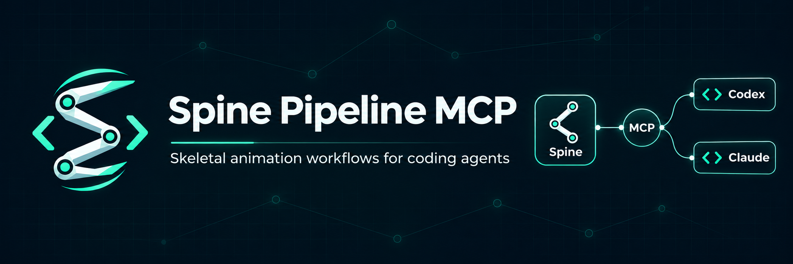

# Spine2d-mcp

[English](README.md) | [简体中文](README_CN.md) | [日本語](README_JA.md) | [한국어](README_KO.md)

**Spine のアセット制作を支援するローカル MCP ツールと汎用 Skills。編集結果は独立したステージングディレクトリに保存します。**

リポジトリ名と表示名は **Spine2d-mcp**、Python パッケージ名と実行コマンドは `spine-pipeline-mcp` です。バナーの未改変の Spine 公式マークは互換性を示すために使用しています。Codex と Claude Code は文字表記であり、公式の推奨や承認を意味しません。第三者の商標は本プロジェクトの MIT ライセンス対象外です。[第三者に関する通知](THIRD_PARTY_NOTICES.md)をご覧ください。

MCP サーバーと Registry 配布パッケージは **0.2.1**、リポジトリプラグインは **0.2.2** です。公式 Python MCP SDK **2.3.0** を使い、stdio で接続します。SDK のバージョンは「MCP プロトコル 2.0」や FastMCP 2.x を意味しません。

## MCP と Skills のインストール

MCP はアセットの読み取り、メッシュとウェイトの編集、アニメーション処理、ネイティブエクスポートを実行します。Skills はレイヤーの準備、リギング、アニメーション制作、ゲームへの組み込みを案内します。両方を組み合わせて利用できます。

3 つの Skills の指示、参考資料、UI メタデータはすべて英語です。README は英語、簡体字中国語、日本語、韓国語で提供しています。

**公開ページ：**[skills.sh の 3 つの Skills](https://skills.sh/rainlib/spine2d-mcp) · [公式 MCP Registry の登録情報](https://registry.modelcontextprotocol.io/v0.1/servers/io.github.RainLib%2Fspine-pipeline-mcp/versions/latest) · [0.2.1 MCPB リリース](https://github.com/RainLib/Spine2d-mcp/releases/tag/v0.2.1)。[Registry の検索画面](https://registry.modelcontextprotocol.io/)では `io.github.RainLib/spine-pipeline-mcp` を検索してください。以下のリポジトリプラグインには 15 個の MCP ツールと 3 つの Skills が含まれます。

### 方法 1：プラグインとしてまとめてインストール

プラグインに対応した新しい Codex CLI：

```sh
codex plugin marketplace add RainLib/Spine2d-mcp
codex plugin add spine-pipeline@rainlib-spine
```

Claude Code：

```sh
claude plugin marketplace add RainLib/Spine2d-mcp
claude plugin install spine-pipeline@rainlib-spine
```

Git、[uv](https://docs.astral.sh/uv/getting-started/installation/)、Python **3.11 以降**が必要です。初回利用時に素材とステージングのディレクトリを設定します。Codex は起動環境の変数を読み取るため、絶対パスを実際のものに置き換え、同じターミナルから起動してください。

```sh
export SPINE_MCP_SOURCE_ROOT=/absolute/path/to/test-assets
export SPINE_MCP_STAGING_ROOT=/absolute/path/to/separate-staging
codex
```

Claude ではプラグインの入力画面、または次のコマンドで設定できます。

```sh
claude plugin configure spine-pipeline@rainlib-spine --values-stdin <<'JSON'
{
  "source_root": "/absolute/path/to/test-assets",
  "staging_root": "/absolute/path/to/separate-staging"
}
JSON
```

素材ディレクトリは事前に作成してください。2 つのディレクトリは重複せず、互いの親子にならないようにします。パスにシンボリックリンクを含めないでください。クライアントの PATH から `uv` を実行できる必要があります。Dock から起動したデスクトップアプリはターミナルの環境変数を継承しない場合があるため、固定パスを設定する場合は次の個別インストール方法を利用できます。詳細は[初回設定ガイド](docs/distribution.md#configure-the-plugin)を参照してください。

JSON の操作だけなら Spine のインストールは不要です。ネイティブエクスポートには、利用者が別途インストールした正規ライセンスの Spine が必要です。

### 方法 2：Skills と MCP を個別にインストール

[skills.sh CLI](https://github.com/vercel-labs/skills)には Node.js **22.20 以降**が必要です。

```sh
npx skills add RainLib/Spine2d-mcp \
  --skill spine-asset-prep spine-rig-animation spine-game-integration \
  --agent codex --global
```

Claude 向けには `--agent claude-code` を指定します。`--global` を省略すると現在のプロジェクトにインストールします。Skills のインストールだけでは MCP は接続されません。Codex に MCP を追加する場合は、手動でリポジトリをクローンせずに次のコマンドを使えます。

```sh
uvx --from git+https://github.com/RainLib/Spine2d-mcp.git@main python -c 'import spine_pipeline_mcp'
codex mcp add spine-pipeline \
  --env SPINE_MCP_SOURCE_ROOT=/absolute/path/to/test-assets \
  --env SPINE_MCP_STAGING_ROOT=/absolute/path/to/separate-staging \
  -- uvx --from git+https://github.com/RainLib/Spine2d-mcp.git@main spine-pipeline-mcp
```

最初のコマンドでダウンロードとビルドを先に行い、初回起動時のタイムアウトを避けます。絶対パスを実際のものに置き換えてください。この方法は Git からビルドするため、PyPI の公開パッケージを必要としません。MCP のバージョンを固定する場合は `main` を `v0.2.1` または完全なコミット ID に置き換えます。Claude 用のコマンド、タイムアウト、更新、アンインストールについては[配布ガイド](docs/distribution.md)を参照してください。同じクライアントで複数の方法を併用すると、ツールや Skills が重複することがあります。

### 方法 3：公式 Registry から MCPB を取得

Registry の登録名は **`io.github.RainLib/spine-pipeline-mcp`** です。登録情報は GitHub Releases の [MCPB ファイル](https://github.com/RainLib/Spine2d-mcp/releases/download/v0.2.1/spine-pipeline-mcp-0.2.1.mcpb)を参照しています。**MCPB 0.4 と UV runtime** に対応したクライアントでインポートし、素材とステージングのディレクトリを入力してください。

このパッケージは macOS/Linux 向けで、初回起動時に Python の依存パッケージをインストールします。含まれるのは MCP サーバーです。Skills は方法 2 で別途インストールします。Registry はサーバーの公開情報を提供し、実際のインストール機能はクライアントに依存します。Codex/Claude Code では方法 1 または 2 を利用できます。チェックサムは [server.json](server.json)、詳細は[Registry インストールガイド](docs/distribution.md#install-from-the-official-mcp-registry)にあります。

### Skills の呼び出し

設定後に新しいセッションを開始し、まず `skeleton_inspect` で素材ディレクトリ内の実際の JSON を読み取ってください。Codex に Skills を個別インストールした場合の例：

```text
$spine-asset-prep を使い、この AI 素材を整理してください。利用可能な PhotoCraft/Photoshop MCP でレイヤーとプレビューを管理してください。
$spine-rig-animation を使い、キャラクターのリグ、メッシュ、ウェイトを調整し、動きと物理による二次動作を検証してください。
$spine-game-integration を使い、指定したゲームにキャラクターを組み込み、スロット、接続点、スキン、アニメーションイベントを確認してください。
```

Codex プラグインでは `$spine-pipeline:spine-rig-animation` のように名前空間を付けます。Claude では個別インストールが `/spine-rig-animation`、プラグインが `/spine-pipeline:spine-rig-animation` です。画像編集アプリとの連携は任意です。Skills は実際に利用できる API に従い、未実装の編集機能を追加するものではありません。[Skills ガイド](docs/skills.md)も参照してください。

## 実装済みの 15 個のツール

| 分類 | ツール |
| --- | --- |
| 読み取り・静的検証 | `skeleton_inspect`、`skeleton_validate`、`job_validate` |
| ステージング | `stage_json_copy`、`stage_asset_bundle`（JSON と参照画像） |
| アニメーション | `animation_copy`、`animation_retime`、`bone_keys_set` |
| ネイティブ処理 | `spine_export`、`godot_validate` |
| メッシュ | `mesh_inspect`、`mesh_weights_get`、`mesh_weights_set`、`mesh_replace`、`mesh_policy_validate` |

変更ごとに新しいジョブを作成し、元ファイルや入力ジョブを上書きしません。アニメーションの速度変更とキーフレーム編集は現在 linear/stepped に対応し、数値形式の Bezier 曲線は拒否します。Spine 4.3 の rotate キーには `value` を使用します。

過去のローカル検証では、ウェイト付きメッシュのコピーからアニメーション編集、**Spine 4.3.26** による `.spine`、JSON、atlas、PNG の出力、ネイティブ Spine 対応 **Godot 4.7.1 カスタムビルド**による読み込み・初期化・短時間の再生確認まで実行しています。全バージョンの互換性や見た目の品質を保証する検証ではありません。使用したゲーム素材やローカルパスは配布しません。

## メッシュ編集の範囲

ボーン参照と循環、UV、三角形インデックス、ウェイト付き頂点の形式、ウェイト合計、タイムラインを検査します。辺を介した連結性、非多様体の辺・頂点、縮退三角形、ウェイトのページ読み取りと編集、明示的なジオメトリ置換にも対応します。ウェイトは正規化し、ボーンインデックス順に並べます。連続した本体、頂点数・影響数の上限、顔の剛性、直接ウェイトや祖先ボーンによる影響の制限を設定できます。

編集対象は **Spine 4.3.x** です。linked mesh、image sequence、Deform/FFD/attachments アニメーションタイムラインを含む文書は拒否します。通常の `slots` 内のアタッチメント切り替えタイムラインは利用できます。ウェイト編集は既存のボーンローカル座標を保持しますが、現在のポーズが変わらないことは保証しません。新しいバインド座標はローカル生成処理で算出し、`mesh_replace` に渡してください。

足の滑り、極端なポーズでの干渉、制約の効果はネイティブ再生と目視で確認する必要があります。透明輪郭からの自動メッシュ生成、ウェイト平滑化、Deform の再マッピングは未実装です。[メッシュと拡張ガイド](docs/mesh.md)を参照してください。

## クライアント設定とローカル開発

**Codex は TOML の `mcp_servers`、Claude Code は JSON の `mcpServers` を使用します。** 形式を混用しないでください。設定例は[クライアントガイド](docs/clients.md)にあります。別の `CODEX_HOME` を使用する設定は、通常の設定を自動では継承しません。

```sh
git clone https://github.com/RainLib/Spine2d-mcp.git
cd Spine2d-mcp
uv sync --locked
uv run --locked pytest -q
uv build
```

ローカル実行の command は `uv`、args は `--directory /path/to/Spine2d-mcp run --locked spine-pipeline-mcp` を個別の配列要素にしたものです。`SPINE_MCP_SOURCE_ROOT` と `SPINE_MCP_STAGING_ROOT` は必須です。まずテスト用の素材コピーを使ってください。

ネイティブ処理には `SPINE_MCP_CLI`（ライセンスのある Spine の絶対パス）、`SPINE_MCP_CLI_VERSION`（素材と完全一致するバージョン）、必要に応じて `SPINE_MCP_GODOT_EXECUTABLE`（ネイティブ `SpineSprite` を含む Godot）を設定します。通常の Godot に Spine 対応が含まれるとは限りません。

出力は独立したステージングに保存し、ゲームへの公開や任意のシェルコマンド実行を行うツールはありません。Godot の検証はゲームの autoload を含まない最小プロジェクトで実行します。Spine は通常のライセンス、キャッシュ、設定にアクセスできるため、これは OS サンドボックスではありません。ステージングの自動削除も行いません。

## 汎用機能とゲーム固有の拡張

公開 Skills：[素材とレイヤーの準備](https://skills.sh/rainlib/spine2d-mcp/spine-asset-prep)、[リギングとアニメーション](https://skills.sh/rainlib/spine2d-mcp/spine-rig-animation)、[ゲーム組み込みとスキン](https://skills.sh/rainlib/spine2d-mcp/spine-game-integration)。特定のゲームの設定は含めません。

ローカルの Python スクリプトから汎用パッケージを読み込み、`ProjectAdapter` に独自の変換と検証を登録できます。検証に合格すると新しいジョブを作成します。ボーン配置、キャラクター固有のルール、接続点、輪郭生成処理は利用側に置き、汎用のウェイト形式、メッシュ検証、エクスポート処理を再利用します。素材ファイルからスクリプトを自動実行することはありません。JSON のみのジョブも編集できますが、エクスポートには画像を含む完全なバンドルが必要です。

リポジトリには汎用コード、合成テスト、文書のみを含め、[MIT ライセンス](LICENSE)で提供します。ゲーム専用素材、ローカルパス、キャラクタールール、非公開の検証資料はリポジトリ外で管理します。商用ソフトウェアの Spine は同梱しません。本プロジェクトは独立したコミュニティプロジェクトであり、Spine の公式製品ではありません。

154 件のテスト、および macOS とクリーンな Linux ARM64 環境での Registry 取得、パッケージのハッシュ確認、実際の MCP 呼び出しが成功しています。[検証記録](docs/distribution.md#maintainer-checks)に範囲を記載しています。完全なアニメーション・画質の検証や、すべてのデスクトップクライアントのインポート画面の検証を意味するものではありません。

CI は[テンプレート](docs/ci-workflow.yml.example)のみ提供しています。公開用認証情報に workflow の書き込み権限がないため、ホスト型 CI は未有効化です。詳細は[英語 README](README.md)、[アーキテクチャ](docs/architecture.md)、[セキュリティモデル](SECURITY.md)をご覧ください。
