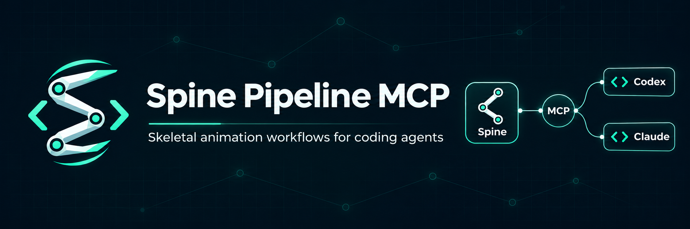

# Spine2d-mcp

[English](README.md) | [简体中文](README_CN.md) | [日本語](README_JA.md) | [한국어](README_KO.md)

**Spine 에셋 제작을 위한 로컬 MCP 도구와 범용 Skills입니다. 편집 결과는 별도의 스테이징 디렉터리에 저장합니다.**

저장소와 표시 이름은 **Spine2d-mcp**이며, Python 패키지와 실행 명령의 이름은 `spine-pipeline-mcp`입니다. 배너의 수정하지 않은 Spine 공식 마크는 호환성을 나타내기 위해 사용합니다. Codex와 Claude Code는 텍스트로 표기하며 공식 추천이나 승인을 의미하지 않습니다. 타사 상표는 이 프로젝트의 MIT 라이선스에 포함되지 않습니다. [타사 고지](THIRD_PARTY_NOTICES.md)를 참고하세요.

MCP 서버와 Registry 배포 패키지는 **0.2.1**, 저장소 플러그인은 **0.2.2** 버전입니다. 공식 Python MCP SDK **2.3.0**을 사용하며 stdio로 연결합니다. SDK 버전은 “MCP 프로토콜 2.0”이나 FastMCP 2.x를 뜻하지 않습니다.

## MCP와 Skills 설치

MCP는 에셋 읽기, 메시와 가중치 편집, 애니메이션 처리, 네이티브 내보내기를 실행합니다. Skills는 레이어 준비, 리깅, 애니메이션 제작, 게임 연동 과정을 안내합니다. 함께 사용하는 것을 권장합니다.

세 Skills의 지침, 참고 문서, UI 메타데이터는 모두 영어로 작성되어 있습니다. README는 영어, 중국어 간체, 일본어, 한국어로 제공합니다.

**공개 페이지:** [skills.sh의 세 Skills](https://skills.sh/rainlib/spine2d-mcp) · [공식 MCP Registry 등록 정보](https://registry.modelcontextprotocol.io/v0.1/servers/io.github.RainLib%2Fspine-pipeline-mcp/versions/latest) · [0.2.1 MCPB 릴리스](https://github.com/RainLib/Spine2d-mcp/releases/tag/v0.2.1). [Registry 검색 화면](https://registry.modelcontextprotocol.io/)에서 `io.github.RainLib/spine-pipeline-mcp`를 검색하세요. 아래 저장소 플러그인에는 MCP 도구 15개와 Skills 3개가 포함됩니다.

### 방법 1: 플러그인으로 함께 설치

플러그인을 지원하는 최신 Codex CLI:

```sh
codex plugin marketplace add RainLib/Spine2d-mcp
codex plugin add spine-pipeline@rainlib-spine
```

Claude Code:

```sh
claude plugin marketplace add RainLib/Spine2d-mcp
claude plugin install spine-pipeline@rainlib-spine
```

Git, [uv](https://docs.astral.sh/uv/getting-started/installation/), Python **3.11 이상**이 필요합니다. 처음 사용할 때 에셋과 스테이징 디렉터리를 설정하세요. Codex는 실행 환경의 변수를 읽으므로 실제 절대 경로로 바꾼 뒤 같은 터미널에서 실행합니다.

```sh
export SPINE_MCP_SOURCE_ROOT=/absolute/path/to/test-assets
export SPINE_MCP_STAGING_ROOT=/absolute/path/to/separate-staging
codex
```

Claude에서는 플러그인 설정 화면을 사용하거나 다음 명령으로 저장할 수 있습니다.

```sh
claude plugin configure spine-pipeline@rainlib-spine --values-stdin <<'JSON'
{
  "source_root": "/absolute/path/to/test-assets",
  "staging_root": "/absolute/path/to/separate-staging"
}
JSON
```

원본 디렉터리는 미리 존재해야 합니다. 두 디렉터리는 겹치거나 서로의 상위·하위 디렉터리가 되어서는 안 되며, 경로에 심볼릭 링크가 없어야 합니다. 클라이언트의 PATH에서 `uv`를 실행할 수 있어야 합니다. Dock에서 실행한 데스크톱 앱은 터미널 환경 변수를 상속하지 않을 수 있으므로 고정 경로가 필요하면 아래의 개별 MCP 설치 방법을 사용할 수 있습니다. 자세한 내용은 [초기 설정 안내](docs/distribution.md#configure-the-plugin)를 참고하세요.

JSON 작업만 할 때는 Spine을 설치할 필요가 없습니다. 네이티브 내보내기에는 사용자가 별도로 설치한 정식 라이선스의 Spine이 필요합니다.

### 방법 2: Skills와 MCP를 각각 설치

[skills.sh CLI](https://github.com/vercel-labs/skills)를 사용하려면 Node.js **22.20 이상**이 필요합니다.

```sh
npx skills add RainLib/Spine2d-mcp \
  --skill spine-asset-prep spine-rig-animation spine-game-integration \
  --agent codex --global
```

Claude에는 `--agent claude-code`를 사용하세요. `--global`을 생략하면 현재 프로젝트에 설치합니다. Skills 설치만으로 MCP가 연결되지는 않습니다. Codex에 MCP를 추가할 때는 저장소를 직접 복제하지 않고 다음 명령을 사용할 수 있습니다.

```sh
uvx --from git+https://github.com/RainLib/Spine2d-mcp.git@main python -c 'import spine_pipeline_mcp'
codex mcp add spine-pipeline \
  --env SPINE_MCP_SOURCE_ROOT=/absolute/path/to/test-assets \
  --env SPINE_MCP_STAGING_ROOT=/absolute/path/to/separate-staging \
  -- uvx --from git+https://github.com/RainLib/Spine2d-mcp.git@main spine-pipeline-mcp
```

첫 명령은 다운로드와 빌드를 미리 완료해 최초 실행 시 클라이언트 시간 초과를 줄입니다. 절대 경로를 실제 경로로 바꾸세요. Git에서 빌드하므로 PyPI 배포 패키지에 의존하지 않습니다. MCP 버전을 고정하려면 `main`을 `v0.2.1` 또는 전체 커밋 ID로 바꿉니다. Claude용 명령, 시간 제한, 업데이트와 제거 방법은 [설치 및 배포 안내](docs/distribution.md)에 있습니다. 같은 클라이언트에서 여러 설치 방법을 함께 사용하면 도구와 Skills가 중복될 수 있습니다.

### 방법 3: 공식 Registry에서 MCPB 받기

Registry 등록 이름은 **`io.github.RainLib/spine-pipeline-mcp`**입니다. 등록 정보는 GitHub Releases의 [MCPB 파일](https://github.com/RainLib/Spine2d-mcp/releases/download/v0.2.1/spine-pipeline-mcp-0.2.1.mcpb)을 가리킵니다. **MCPB 0.4와 UV runtime**을 지원하는 클라이언트로 가져온 뒤 원본과 스테이징 디렉터리를 입력하세요.

이 패키지는 macOS/Linux용이며 최초 실행 시 Python 의존성을 설치합니다. MCP 서버가 포함되어 있고, Skills는 방법 2로 별도 설치합니다. Registry는 서버 검색용 메타데이터를 제공하며 실제 설치 기능은 클라이언트에 따라 다릅니다. Codex/Claude Code에서는 방법 1이나 2를 사용할 수 있습니다. 체크섬은 [server.json](server.json), 자세한 요구 사항은 [Registry 설치 안내](docs/distribution.md#install-from-the-official-mcp-registry)를 참고하세요.

### Skills 호출

설정 후 새 세션을 열고 먼저 `skeleton_inspect`로 원본 디렉터리 안의 실제 JSON을 읽어 연결을 확인하세요. Codex에 Skills를 개별 설치했을 때의 예시입니다.

```text
$spine-asset-prep으로 이 AI 에셋을 정리하고, 사용 가능한 PhotoCraft/Photoshop MCP로 레이어와 미리보기를 관리해 주세요.
$spine-rig-animation으로 캐릭터의 리그, 메시, 가중치를 조정하고 동작과 물리 기반 보조 움직임을 검증해 주세요.
$spine-game-integration으로 지정한 게임에 캐릭터를 연동하고 슬롯, 소켓, 스킨, 애니메이션 이벤트를 확인해 주세요.
```

Codex 플러그인에서는 `$spine-pipeline:spine-rig-animation`처럼 네임스페이스를 붙입니다. Claude에서는 개별 설치 시 `/spine-rig-animation`, 플러그인 설치 시 `/spine-pipeline:spine-rig-animation`을 사용합니다. 이미지 편집기 연동은 선택 사항입니다. Skills는 실제로 사용 가능한 API를 따르며, 아직 구현되지 않은 편집 기능을 추가하지는 않습니다. [Skills 안내](docs/skills.md)를 참고하세요.

## 구현된 도구 15개

| 분류 | 도구 |
| --- | --- |
| 읽기 및 정적 검증 | `skeleton_inspect`, `skeleton_validate`, `job_validate` |
| 스테이징 | `stage_json_copy`, `stage_asset_bundle` — JSON과 참조 이미지 |
| 애니메이션 | `animation_copy`, `animation_retime`, `bone_keys_set` |
| 네이티브 처리 | `spine_export`, `godot_validate` |
| 메시 | `mesh_inspect`, `mesh_weights_get`, `mesh_weights_set`, `mesh_replace`, `mesh_policy_validate` |

변환마다 새 작업(job)을 만들며 원본 파일이나 입력 작업을 덮어쓰지 않습니다. 애니메이션 속도 변경과 키프레임 편집은 현재 linear/stepped를 지원하고 숫자 형식의 Bezier 곡선은 거부합니다. Spine 4.3의 rotate 키에는 `value`를 사용합니다.

기존 로컬 검증에서는 가중치가 있는 메시의 복사본을 편집하고, **Spine 4.3.26**으로 `.spine`, JSON, atlas, PNG를 내보낸 뒤, 네이티브 Spine을 지원하는 **Godot 4.7.1 커스텀 빌드**로 로드·초기화·짧은 애니메이션 샘플링을 수행했습니다. 모든 버전의 호환성이나 시각적 품질을 보장하는 검증은 아닙니다. 사용한 게임 에셋과 로컬 경로는 배포하지 않습니다.

## 메시 편집 범위

본 참조와 순환, UV, 삼각형 인덱스, 가중치가 있는 정점의 인코딩, 가중치 합계, 타임라인을 검사합니다. 에지를 통한 연결성, 비다양체 에지·정점, 퇴화 삼각형, 페이지 단위 가중치 읽기와 편집, 명시적인 지오메트리 교체도 지원합니다. 가중치는 정규화하고 본 인덱스순으로 정렬합니다. 연속된 몸체, 정점·영향 개수 제한, 얼굴 강체 유지, 직접 가중치와 상위 본의 영향 제한을 규칙으로 설정할 수 있습니다.

편집은 **Spine 4.3.x**를 지원합니다. linked mesh, image sequence, Deform/FFD/attachments 애니메이션 타임라인을 포함한 문서는 거부합니다. 일반적인 `slots` 아래의 어태치먼트 전환 타임라인은 사용할 수 있습니다. 가중치 편집은 기존 본 로컬 좌표를 유지하지만 현재 포즈가 그대로 유지됨을 보장하지는 않습니다. 새 바인딩 좌표는 로컬 생성기에서 계산해 `mesh_replace`에 전달해야 합니다.

발 미끄러짐, 극단적인 포즈에서의 겹침, 제약 조건의 효과는 네이티브 재생과 시각적 검토가 필요합니다. 투명 윤곽 기반 자동 메시 생성, 가중치 평활화, Deform 재매핑은 아직 구현되지 않았습니다. [메시와 확장 안내](docs/mesh.md)를 참고하세요.

## 클라이언트 설정과 로컬 개발

**Codex는 TOML의 `mcp_servers`, Claude Code는 JSON의 `mcpServers`를 사용합니다.** 두 형식을 혼용하지 마세요. 설정 예시는 [클라이언트 안내](docs/clients.md)에 있습니다. 별도의 `CODEX_HOME`을 사용하면 기본 설정을 자동으로 상속하지 않습니다.

```sh
git clone https://github.com/RainLib/Spine2d-mcp.git
cd Spine2d-mcp
uv sync --locked
uv run --locked pytest -q
uv build
```

로컬 실행의 command는 `uv`이고, args는 `--directory /path/to/Spine2d-mcp run --locked spine-pipeline-mcp`를 각각 배열 요소로 나눈 값입니다. `SPINE_MCP_SOURCE_ROOT`와 `SPINE_MCP_STAGING_ROOT`는 필수입니다. 처음에는 테스트용 에셋 복사본을 사용하세요.

네이티브 처리에는 `SPINE_MCP_CLI` — 라이선스가 있는 Spine의 절대 경로, `SPINE_MCP_CLI_VERSION` — 에셋과 정확히 일치하는 버전, 필요에 따라 `SPINE_MCP_GODOT_EXECUTABLE` — 네이티브 `SpineSprite`를 포함하는 Godot 경로를 설정합니다. 일반 Godot 설치에 Spine 지원이 포함되어 있다고 가정하면 안 됩니다.

모든 출력은 독립된 스테이징에 저장하며, 게임에 배포하거나 임의의 셸 명령을 실행하는 도구는 없습니다. Godot 검증은 게임의 autoload가 없는 최소 프로젝트에서 실행합니다. Spine은 일반 라이선스·캐시·설정에 접근할 수 있으므로 OS 샌드박스는 아닙니다. 스테이징을 자동으로 정리하지도 않습니다.

## 범용 기능과 게임별 확장

공개 Skills: [에셋과 레이어 준비](https://skills.sh/rainlib/spine2d-mcp/spine-asset-prep), [리깅과 애니메이션](https://skills.sh/rainlib/spine2d-mcp/spine-rig-animation), [게임 연동과 스킨](https://skills.sh/rainlib/spine2d-mcp/spine-game-integration). 특정 게임의 설정은 포함하지 않습니다.

로컬 Python 스크립트에서 범용 패키지를 가져와 `ProjectAdapter`에 자체 변환과 검증을 등록할 수 있습니다. 검증을 통과한 뒤 새 작업을 만듭니다. 본 배치, 캐릭터별 규칙, 소켓, 윤곽 생성기는 사용하는 프로젝트에 두고, 공통 가중치 인코딩·메시 검증·내보내기를 재사용합니다. 에셋 파일에서 스크립트를 자동 실행하지 않습니다. JSON만 있는 작업도 편집할 수 있지만 내보내기에는 이미지를 포함한 전체 번들이 필요합니다.

이 저장소는 범용 코드, 합성 테스트, 문서를 [MIT 라이선스](LICENSE)로 제공합니다. 게임 전용 에셋, 로컬 경로, 캐릭터 규칙, 비공개 검증 자료는 저장소 밖에서 관리합니다. 상용 소프트웨어인 Spine은 포함하지 않습니다. 이 프로젝트는 독립적인 커뮤니티 프로젝트이며 Spine의 공식 제품이 아닙니다.

테스트 154개와 macOS 및 깨끗한 Linux ARM64 환경에서의 Registry 조회, 패키지 해시 확인, 실제 MCP 호출 검증을 통과했습니다. 자세한 범위는 [검증 기록](docs/distribution.md#maintainer-checks)에 있습니다. 전체 애니메이션·시각적 품질 또는 모든 데스크톱 클라이언트의 가져오기 화면을 검증했다는 뜻은 아닙니다.

CI는 [템플릿](docs/ci-workflow.yml.example)만 제공합니다. 배포용 인증 정보에 workflow 쓰기 권한이 없어 호스팅 CI는 아직 활성화하지 않았습니다. 자세한 내용은 [영문 README](README.md), [아키텍처](docs/architecture.md), [보안 모델](SECURITY.md)을 참고하세요.
