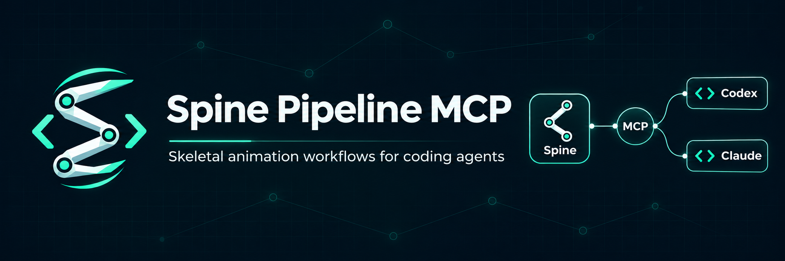

# Spine2d-mcp

仓库/展示名称改为 **Spine2d-mcp**；Python包名和启动命令继续使用 `spine-pipeline-mcp`，不影响既有客户端。项目icon保持原样，仅横幅更新。横幅独立展示未修改的Spine官方标志，Codex与Claude Code使用普通文字，不表示官方背书。第三方标志不归本项目MIT许可，见[第三方声明](../THIRD_PARTY_NOTICES.md)。

项目 **0.2.0**，采用 Python 官方 MCP SDK **2.3.0**，通过 stdio 使用。它不是“协议 2.0”或 FastMCP 2.x。

## 安装 MCP 和 Skills

MCP 执行素材读取、Mesh／权重修改、动画处理和原生导出；Skills 指导代理完成素材分层、绑定动画和游戏接入。推荐一起使用。

> **发布状态：**本次新增的 Skills 和市场清单尚未发布；以下 GitHub 技能／插件命令需要这些文件进入所选远程 ref 后才能使用。现在可使用[本地 checkout 安装](distribution.md#local-checkout-before-publication)。仓库市场可安装与公共商城已收录是两件事。

### 方式一：插件市场一起安装

新版 Codex CLI：

```sh
codex plugin marketplace add RainLib/Spine2d-mcp
codex plugin add spine-pipeline@rainlib-spine
```

Claude Code：

```sh
claude plugin marketplace add RainLib/Spine2d-mcp
claude plugin install spine-pipeline@rainlib-spine
```

插件包含 MCP 和全部三项 Skills，需要本机有 [uv](https://docs.astral.sh/uv/getting-started/installation/) 与 Python 3.11+。首次使用仍需[设置素材目录和暂存目录](distribution.md#configure-the-plugin)：Codex 从启动环境读取 `SPINE_MCP_SOURCE_ROOT`、`SPINE_MCP_STAGING_ROOT`；Claude 可通过插件配置提示填写。两个目录不得重叠。仅操作 JSON 不需要安装 Spine；原生导出需要用户自己的正版 Spine。

### 方式二：分别安装

Skills 可以直接通过 [skills.sh 的 CLI](https://github.com/vercel-labs/skills) 从仓库拉取，需要 Node.js 22.20+：

```sh
npx skills add RainLib/Spine2d-mcp \
  --skill spine-asset-prep spine-rig-animation spine-game-integration \
  --agent codex --global
```

Claude 使用 `--agent claude-code`；省略 `--global` 安装到当前项目。安装 Skills 不会自动连接 MCP。Codex 的 MCP 可免手动克隆安装：

```sh
codex mcp add spine-pipeline \
  --env SPINE_MCP_SOURCE_ROOT=/absolute/path/to/test-assets \
  --env SPINE_MCP_STAGING_ROOT=/absolute/path/to/separate-staging \
  -- uvx --from git+https://github.com/RainLib/Spine2d-mcp.git@main spine-pipeline-mcp
```

先替换绝对路径；源目录需要已经存在。此命令从 Git 构建，不依赖 PyPI 发布；需要固定版本时将 `main` 换成真实的发布 tag 或完整 commit。首次安装预热、Claude 对应命令、升级卸载、商城与 MCP Registry 的发布区别见[安装与分发指南](distribution.md)。同一客户端选择一种安装路径，避免重复加载。

### 调用示例

安装并配置后开启新会话，先要求代理调用 `skeleton_inspect` 读取源目录内的真实 JSON，再使用技能：

```text
使用 $spine-asset-prep 整理这些 AI 素材；有可用 PhotoCraft／Photoshop MCP 时优先在其中管理图层和预览。
使用 $spine-rig-animation 调整角色骨架、Mesh 和权重，并验证动作效果与物理次级运动。
使用 $spine-game-integration 接入我指定的游戏工程，处理 Slot、挂点、换肤和动画事件。
```

Claude 的独立技能使用 `/spine-rig-animation`；插件安装使用 `/spine-pipeline:spine-rig-animation`。Photo 编辑器为可选项；技能按实际可用接口工作，不会自动补齐尚未实现的编辑能力。详见[技能指南](skills.md)。

## 已实现 15 个工具

- 读取/静态检查：`skeleton_inspect`、`skeleton_validate`、`job_validate`。
- 暂存：`stage_json_copy`、`stage_asset_bundle`（JSON + 引用图片）。
- 动画：`animation_copy`、`animation_retime`、`bone_keys_set`。
- 原生管线：`spine_export`、`godot_validate`。
- Mesh：`mesh_inspect`、`mesh_weights_get`、`mesh_weights_set`、`mesh_replace`、`mesh_policy_validate`。

变换都会创建新 job，不覆盖源文件或输入 job。动画变速和关键帧编辑暂只支持线性/stepped，遇到数字Bezier曲线明确拒绝。rotate 使用 Spine 4.3 的 `value` 字段。

本地真实副本验证已覆盖：weighted mesh素材 → 动画复制/变速/关键帧调整 → Spine **4.3.26** 导出 `.spine`、JSON、atlas、PNG → 原生 Spine-enabled Godot **4.7.1 custom build** 加载/初始化/短动画采样。不是全部版本兼容保证，也不是视觉质量验收；测试游戏素材和本地路径不公开。

## 整体 Mesh 的边界

可检查骨骼引用/循环、UV、三角索引、weighted vertices编码、权重和与时间线。新增按边连接的拓扑检查、非流形顶点/边、退化三角形、权重分页读取与局部修改、完整几何替换；写回权重归一化并按骨骼索引排序。规则可配置主体连续、顶点/影响骨骼预算、脸部刚性、披风直接权重和祖先骨骼隔离。

编辑只支持 Spine 4.3.x；包含 linked mesh、sequence 或 deform/FFD/attachment 动画时间线的文档会明确拒绝修改。权重修改保留原有骨骼局部坐标，不承诺当前姿态不变；新绑定需由本地生成器提供坐标，再调用 `mesh_replace`。脚不漂移、极限动作不穿插、约束效果仍需原生采样和视觉验收。自动透明轮廓布网、权重平滑和 Deform 重映射尚未迁移。详见 [Mesh 与扩展指南](mesh.md)。

## Codex / Claude 接入

完整步骤与模板见[接入指南](clients.md)。**Codex 使用 TOML 的 `mcp_servers`，Claude Code 使用 JSON 的 `mcpServers`，不能混用。** Codex 已实测真实只读工具调用；Claude目前只验证独立配置的Connected健康状态，未声称模型驱动调用已通过。使用独立 `CODEX_HOME` 的API模式不会自动继承默认配置。

## 使用

依赖安装与测试：`uv sync --locked`、`uv run --locked pytest -q`。
客户端 command 为 `uv`，args 为 `--directory /path/to/Spine2d-mcp run --locked spine-pipeline-mcp`（各项拆为数组）。

必须设置两个不重叠目录：`SPINE_MCP_SOURCE_ROOT`、`SPINE_MCP_STAGING_ROOT`。首次使用测试副本。
CLI额外需要 `SPINE_MCP_CLI`（已授权本机Spine绝对路径）、`SPINE_MCP_CLI_VERSION`（精确版本）；Godot检查需要 `SPINE_MCP_GODOT_EXECUTABLE`（含原生SpineSprite的版本，不能默认普通Godot）。

所有输出只写独立暂存，无发布到游戏的工具；无任意shell执行。Godot生成最小隔离项目，无游戏autoload。Spine输出隔离，但仍可能读写正常许可证/缓存/设置，不是OS沙箱。暂存不自动清理。

## 开源与本地分离

新增三项可复用制作技能：素材与图层准备、Spine 骨架动画、游戏接入与换肤。它们可选探测 PhotoCraft／Photoshop MCP，使用当前真实能力，不内置任何消费方游戏配置。安装和调用方式见 [通用制作 Skills](skills.md)。

仓库仅通用代码、合成测试和文档，MIT许可。游戏专有资产、本地路径、角色策略、测试结果放在仓库外的本地适配器中。Spine商业软件不随项目分发。本项目非官方Spine产品。

本地能力不足时可直接扩展：项目侧 Python 脚本 import 通用包，通过 `ProjectAdapter` 注册自己的变换和校验；通过后才生成新 job。骨点布局、角色部件策略、技能挂点和现有透明轮廓生成器留在项目侧，通用权重编码、网格检查和导出链路可以复用。无需为每个角色改核心，也不会从素材文件自动执行脚本。JSON-only 暂存现在也能直接作为编辑输入；导出仍需完整图片 bundle。

CI仅提供 [模板](ci-workflow.yml.example)，当前发布凭据缺workflow权限，云端CI未启用。详细配置与架构见[主README](../README.md)。
